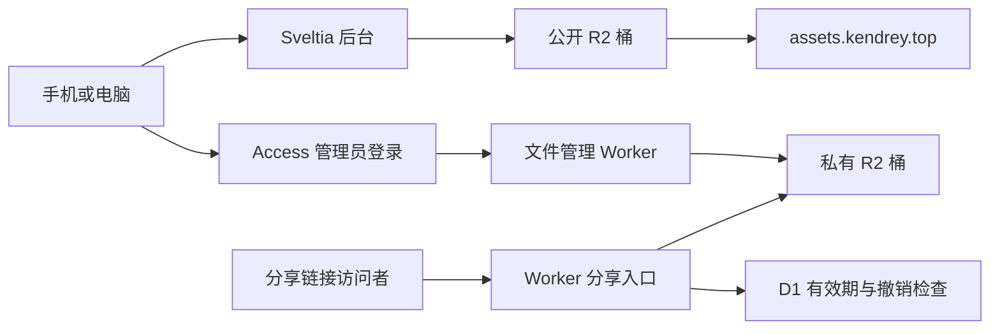

# 图床与文件服务规划

用户已创建公开资源桶 `timeless782` 并提供开发公开地址；接入材料保存在 [`_cloudflare/r2/`](../_cloudflare/r2/README.zh-CN.md)。Sveltia 的 R2 媒体库尚待 Access Key ID、桶 CORS 和浏览器 Secret 配置后启用。私有桶、文件管理和限时分享仍为下述规划。

建议使用 **Cloudflare R2 存储文件，Sveltia 管理公开资源，Worker 管理私密文件与限时分享**。文章仍由现有 GitHub Pages 发布。

## 推荐结构

| 用途 | 建议入口 | 存储与管理方式 |
| --- | --- | --- |
| 博客文章管理 | `admin.kendrey.top/admin/` | 独立 Worker 托管 Sveltia，Cloudflare Access 验证管理员身份后才返回管理页面 |
| 博客图片与公开附件 | `assets.kendrey.top/images/…`、`assets.kendrey.top/files/…` | 一个公开 R2 桶，Sveltia 原生媒体库上传、搜索、选择和删除 |
| 私密文件管理 | `files.kendrey.top/admin/` | 独立私有 R2 桶；手机、电脑使用同一管理页，通过 Cloudflare Access 登录 |
| 临时对外分享 | `files.kendrey.top/s/<随机令牌>` | Worker 检查分享有效期与撤销状态，再读取私有桶；访问者无需管理员账号 |

公开桶与私有桶分开。私有桶不启用公共自定义域名或 `r2.dev`，文件的读取和管理均经过 Worker。

## 公开图床：直接接入 Sveltia

当前固定的 Sveltia **0.250.0 已原生支持 Cloudflare R2**，无需另外开发 CMS 插件。配置项为 `media_libraries.cloudflare_r2`，包含 Account ID、Bucket、Access Key ID 和 `public_url`；Secret Access Key 由管理员在 CMS 设置中输入，不提交到公开仓库。

- 一个公开桶内使用 `images/`、`files/` 两个目录，适配当前每种存储服务一个配置入口的方式。
- `public_url` 指向正式自定义域名。R2 的 S3 API 端点需要认证，不能当作公开图片链接；`r2.dev` 仅用于开发验证。
- 桶 CORS 只允许实际使用的 CMS 域名。固定版本 Sveltia 0.250.0 原生 R2 使用 `GET`、`HEAD`、`PUT`、`DELETE`，通过单次 PUT 上传文件；请求头覆盖签名、类型、校验和及复制操作所需字段。CORS 本身不提供上传权限，写入仍需限定到该桶的对象读写凭据。
- 建议普通照片在上传时生成最大宽度 1920 像素、质量约 82 的 WebP；保留 GIF 动画。原图另行备份。
- 一期建议单文件上限 50 MB，常用格式为图片、PDF、Office、TXT、ZIP。公开资源使用带随机后缀的文件名，减少误覆盖；可设置长缓存，替换内容时生成新链接。

新上传先使用新地址，现有 `img/posts/` 保持可用。迁移旧图时先复制并验证链接，再替换正文引用。

## 管理页面入口鉴权

Sveltia 的 GitHub 登录控制文章写入，R2 凭据控制对象读写；两者均不能阻止访客打开公开的静态管理页面。按用户要求，独立管理入口增加 Cloudflare Access 邮箱验证，并在 Worker 中验证签名、issuer、audience、有效期和邮箱白名单后才读取静态资源。静态资源设置 `run_worker_first: true`，关闭 `workers.dev` 和预览入口。

上线时先验证新入口的允许/拒绝行为，再从 Jekyll 构建产物排除原后台文件，并将博客管理链接切换到新域名。只在博客域名保护 `/admin/*` 会遗漏无尾斜线的 `/admin`，也不能为静态 Pages 源站提供服务端校验。具体部署材料见 [`_cloudflare/admin/`](../_cloudflare/admin/README.md)。源代码仓库保持公开，不保存任何 Secret 或实际邮箱白名单。

## 私密文件：账号管理与可过期分享

Sveltia 的 R2 媒体库面向可通过 `public_url` 访问的资源。文件使用独立的 Worker 管理页，提供上传、列表、搜索、下载、删除和创建/撤销分享。新上传默认私密；明确选择公开的附件写入公开桶 `files/` 目录，私密文件写入独立私有桶。

1. `/admin/` 与管理 API 通过 Cloudflare Access 限定管理员账号；`/s/` 分享入口按链接权限访问。Worker 验证 Access JWT 的签名、签发方和应用 audience；关闭非正式的 `workers.dev` 入口，避免遗漏访问控制。
2. Worker 使用 R2 binding 读写私有桶，浏览器不持有该桶的访问密钥。手机、电脑采用例如 8 MiB 分片上传，逐片校验管理员权限，完成后合并；不将整个文件读入 Worker 内存。总文件大小上限在容量与套餐确认后设定。
3. 分享令牌使用至少 128 位随机数，数据库只保存令牌哈希、对象标识、过期时间、撤销状态和创建时间。提供 1 小时、1 天、7 天及自定义有效期；一期可将自定义上限设为 30 天。
4. 每次分享下载均先查询 D1，再读取 R2，`HEAD`、Range 与条件请求也重新鉴权。鉴权结果不放入 CDN 缓存；下载响应设置 `Cache-Control: private, no-store`、安全的文件名和下载类型，支持流式响应及断点续传。
5. 到期或撤销后，新的请求拒绝访问。已经建立的下载不会被强制中断；恢复下载、分段请求会重新检查权限。已被收件人保存的副本无法通过链接到期收回。链接过期不自动删除文件，文件由管理员另行删除。

**分享状态建议使用 D1。** KV 跨地区更新可能延迟 60 秒或更久，不适合承诺及时撤销。D1 权限检查直接查询主库；若未来启用读副本，鉴权查询仍使用主库约束。

这里使用自定义域名上的 Worker 分享链接，不直接使用 S3 预签名 URL。R2 官方 S3 预签名链接最长 7 天，且不能用于自定义域名；Worker 可以按应用规则设置有效期和撤销。

## 成本与替代方案

| 方案 | 适用性与维护成本 |
| --- | --- |
| **R2 + Worker + D1 + Access（推荐）** | 同时覆盖公开图片、公开附件、私密文件和限时分享；服务托管，无需维护虚拟机 |
| Cloudinary / Uploadcare + 单独私密文件服务 | Sveltia 也原生支持，适合重视图片变换的场景；文件与分享需另一套服务，费用按各自套餐核实 |
| VPS + MinIO / Garage 等 S3 兼容存储 | 控制权高，Sveltia 可通过 S3 接入；系统更新、备份、监控和出口带宽需要自行维护 |

R2 Standard 当前官方免费额度为每月 10 GB-month 存储、100 万次 Class A 操作、1000 万次 Class B 操作；互联网出口流量不收费。超出后按存储与请求量收费。Worker 请求/执行、D1 查询/存储、Access 套餐及独立备份可能另计，不能将整体方案视为永久零成本。

上线时设置用量与预算提醒；每周独立备份文件和 D1 分享元数据，并抽查恢复。博客 Git 提交历史不能恢复被删掉的 R2 文件。

## 实施顺序与验收

1. 绑定 Cloudflare 账号并确认域名 DNS 管理权限，开通 R2；在同一账号中准备资源域名，创建公开/私有两个桶。
2. 为公开桶绑定域名与 CORS，在 Sveltia 安全设置中绑定限定桶的凭据；验证手机、电脑上传图片和附件，正文链接可公开访问。
3. 部署私有文件 Worker、D1 与 Access 管理页；验证未登录不能管理或直接读取私有对象。
4. 验证分享创建、到期、主动撤销、重复下载和 Range 请求；到期/撤销后的新请求必须失败，且不得通过缓存绕过。
5. 完成独立备份恢复演练，再按需迁移旧图片和附件。

存储桶信息已记录，接入和鉴权代码按上述目录准备。配置草稿和本地测试不代表已完成线上部署；云账号凭据通过安全设置绑定，实际部署后再验证并切换管理入口。

## 依据

- [Sveltia 0.250.0 配置类型](https://github.com/sveltia/sveltia-cms/blob/main/src/lib/types/public.js)、[原生 R2 服务](https://github.com/sveltia/sveltia-cms/blob/main/src/lib/services/integrations/media-libraries/cloud/s3/cloudflare-r2.js)
- [R2 公开桶与自定义域名](https://developers.cloudflare.com/r2/buckets/public-buckets/)、[浏览器 CORS](https://developers.cloudflare.com/r2/buckets/cors/)
- [R2 价格与免费额度](https://developers.cloudflare.com/r2/pricing/)、[S3 预签名链接范围](https://developers.cloudflare.com/r2/api/s3/presigned-urls/)
- [Access JWT 验证](https://developers.cloudflare.com/cloudflare-one/access-controls/applications/http-apps/authorization-cookie/validating-json/)、[KV 一致性](https://developers.cloudflare.com/kv/concepts/how-kv-works/)、[D1 读副本与主库](https://developers.cloudflare.com/d1/best-practices/read-replication/)
